# Cache-aside on Azure: infrastructure

This is a learning project. It implements the architecture from the Azure Architecture Center article [Cache-aside caching using Azure Managed Redis and Azure Database for PostgreSQL](https://learn.microsoft.com/en-us/azure/architecture/databases/architecture/cache-aside-azure-managed-redis-postgresql) with Bicep, so you can deploy it, test it, and delete it at any time.

> [!NOTE]
> This is a personal learning implementation. It is not official Microsoft guidance.

This repository is [azure-cache-aside-infra-architecture](https://github.com/tttaufiqqq/azure-cache-aside-infra-architecture). It contains the Azure infrastructure. The web app lives in a separate repository, [cache-aside-app](https://github.com/tttaufiqqq/azure-cache-aside-app).

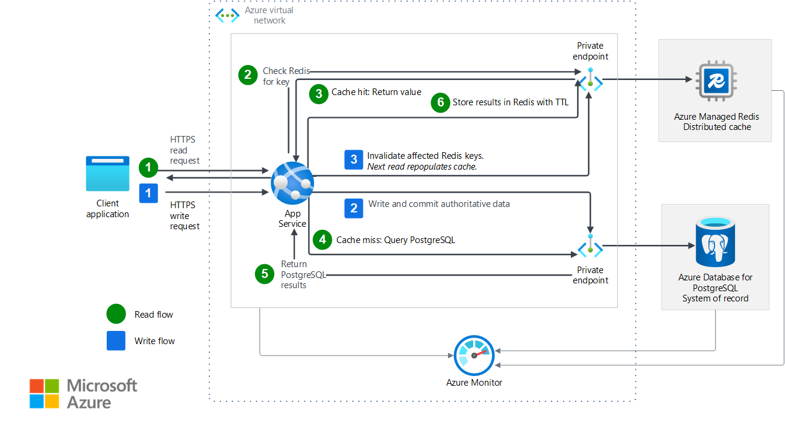
*Architecture diagram of the cache-aside pattern with Azure Managed Redis and Azure Database for PostgreSQL.*

Diagram adapted from the [Azure Architecture Center](https://learn.microsoft.com/en-us/azure/architecture/databases/architecture/cache-aside-azure-managed-redis-postgresql).

## 1. Learning goals

- Understand the cache-aside pattern, including its read path, write path, and failure modes.
- Connect App Service to data services over private endpoints.
- Authenticate with a managed identity and Microsoft Entra ID instead of passwords or keys.
- Deploy and delete a complete environment with Bicep.

## 2. What this deploys

| Resource | Purpose |
|---|---|
| App Service (Linux, B1) | Hosts the web app |
| Azure Managed Redis (Balanced B0) | Stores cached data |
| Azure Database for PostgreSQL flexible server (Burstable B1ms) | Stores the source of truth |
| Virtual network, two subnets, two private endpoints | Keeps data traffic off the public internet |
| Two private DNS zones | Resolve the private endpoints |
| User-assigned managed identity | Authenticates the app to both data services |
| Log Analytics workspace and Application Insights | Collect logs and metrics |

The default region is Malaysia West. For a full explanation, see [Architecture](docs/architecture.md).

## 3. Prerequisites

- An Azure subscription
- [Azure CLI](https://learn.microsoft.com/en-us/cli/azure/install-azure-cli) with Bicep (`az bicep install`)
- Permission to create resources in your subscription
- The resource providers `Microsoft.Cache`, `Microsoft.DBforPostgreSQL`, `Microsoft.Web`, `Microsoft.Network`, `Microsoft.OperationalInsights`, `Microsoft.Insights`, and `Microsoft.ManagedIdentity` registered on the subscription

## 4. Quickstart

Sign in to Azure first.

```bash
az login
```

### 4.1 Bash (Git Bash or WSL)

1. Deploy the infrastructure.

   ```bash
   ./scripts/deploy.sh
   ```

   The script previews the changes and asks for confirmation before it deploys.

1. Deploy the web app by following the [cache-aside-app](https://github.com/tttaufiqqq/azure-cache-aside-app) repository.

1. Delete everything when you finish.

   ```bash
   ./scripts/destroy.sh
   ```

### 4.2 PowerShell

The scripts are bash scripts, so PowerShell hands them to Git Bash, which closes its window when the script ends. Run the Azure CLI commands directly instead, so you can read the output.

1. Create the resource group and deploy.

   ```powershell
   az group create --name rg-cache-aside-lab --location malaysiawest
   az deployment group create --name cache-aside --resource-group rg-cache-aside-lab --parameters main.bicepparam
   ```

1. Read the outputs.

   ```powershell
   az deployment group show -g rg-cache-aside-lab -n cache-aside --query properties.outputs
   ```

1. Deploy the web app by following the [cache-aside-app](https://github.com/tttaufiqqq/azure-cache-aside-app) repository.

1. Delete everything when you finish.

   ```powershell
   az group delete --name rg-cache-aside-lab --yes
   ```

For more detail, see [Deploy, redeploy, and destroy](docs/deploy.md).

> [!WARNING]
> Azure Managed Redis, PostgreSQL, App Service, and private endpoints all bill while they exist. Delete the resource group when you finish.

## 5. Results

The deployment creates about two dozen resources and takes around 10 minutes, and Azure Managed Redis is the slowest part.

### 5.1 Sign in and register the providers

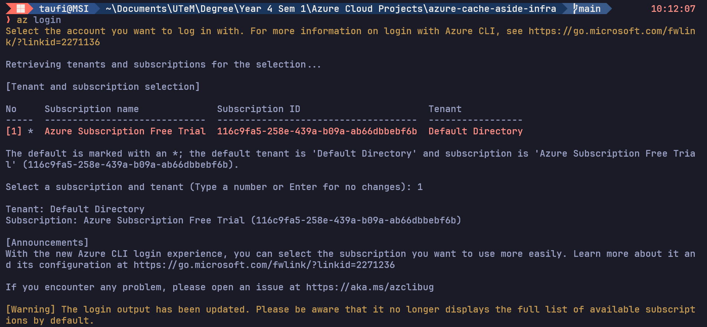
*Azure CLI az login output with the tenant and subscription selection.*

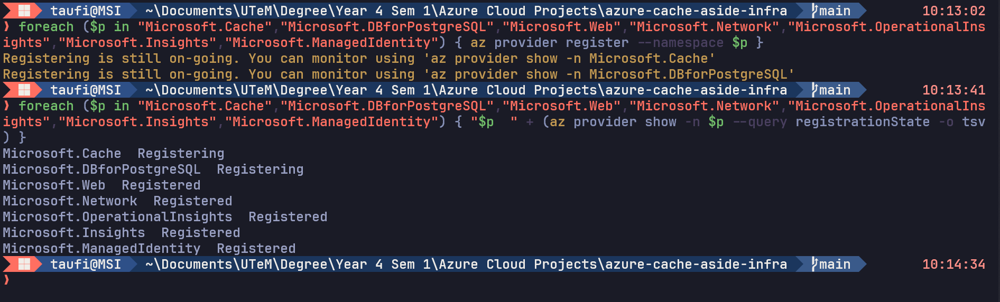
*Azure CLI output showing the foreach loop that registers the resource providers.*

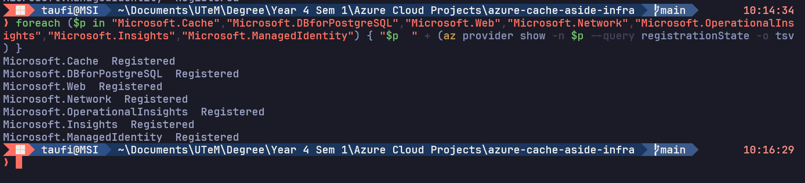
*Azure CLI output showing each provider state with Microsoft.Cache registered.*

Registration can take a few minutes. `Microsoft.Cache` and `Microsoft.DBforPostgreSQL` were the slowest.

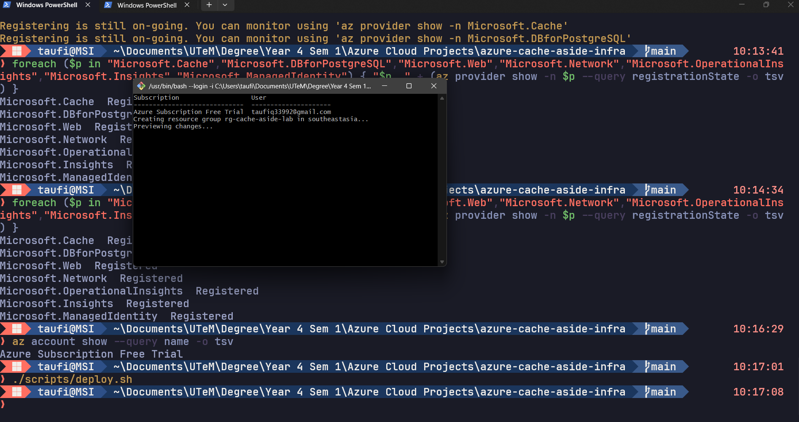
*PowerShell output showing Microsoft.Cache and Microsoft.DBforPostgreSQL still registering.*

### 5.2 The first deploy attempt

The `what-if` preview lists only the first eight resources. The nested modules for PostgreSQL, Redis, private endpoints, and App Service depend on values that exist only at deployment time, so `what-if` skips them and reports `NestedDeploymentShortCircuited`.

Running the deploy script from PowerShell opens a separate Git Bash window that closes when the script ends, so the output disappears.

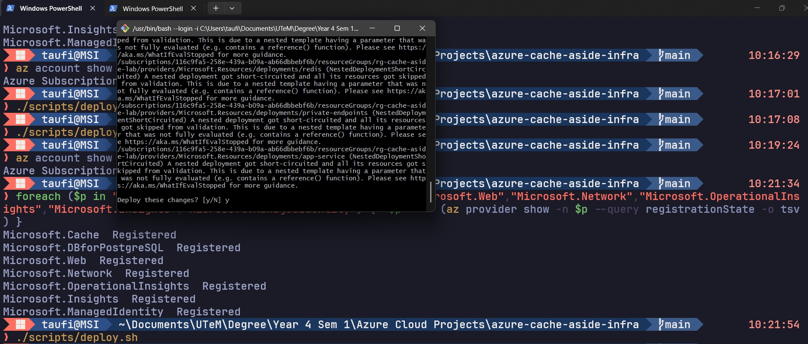
*Git Bash window that opens when the deploy script runs from PowerShell.*

Listing the deployments from PowerShell shows the module deployments succeeded while the main deployment failed.

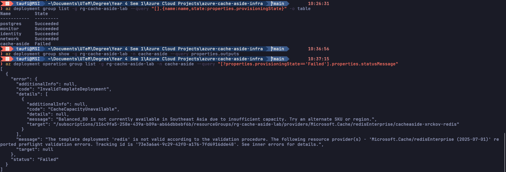
*Azure CLI output listing the deployments and the failed operation status.*

The portal showed the same state: four module deployments succeeded while the main deployment was still running.

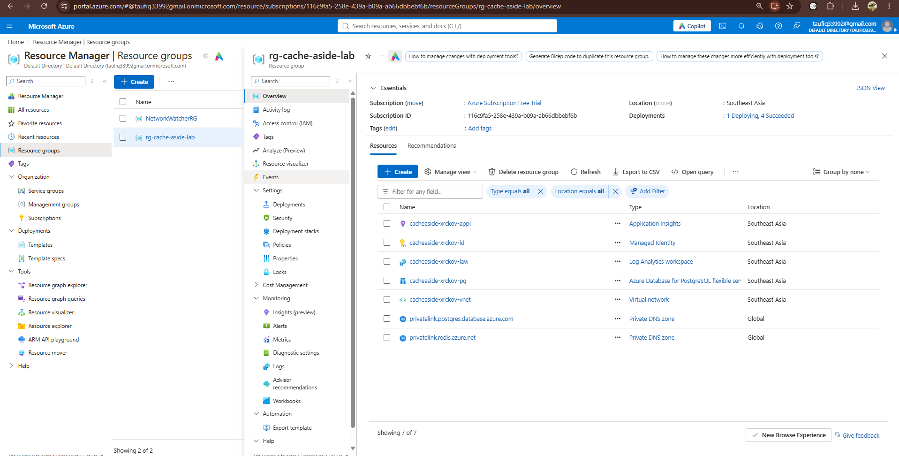
*Azure portal overview of the resource group during the Southeast Asia attempt.*

### 5.3 Capacity error in Southeast Asia

Azure rejected `Balanced_B0` in Southeast Asia with `CacheCapacityUnavailable`, and the next size up, `Balanced_B1`, failed the same way.

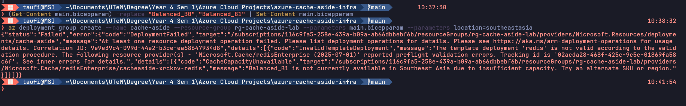
*Azure CLI output showing the redisSku change to Balanced_B1 and the failed redeploy in Southeast Asia.*

The fix was to move the deployment to Malaysia West. Existing resources can't change region, so the resource group was deleted and recreated.

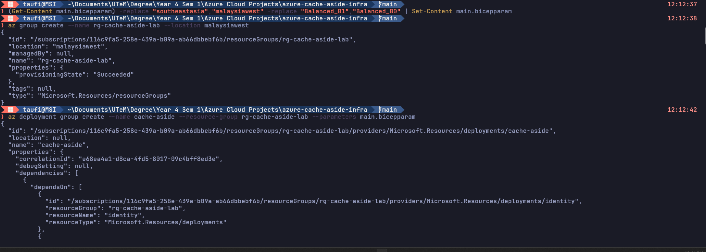
*Azure CLI output showing the resource group recreated in Malaysia West.*

### 5.4 Successful deployment

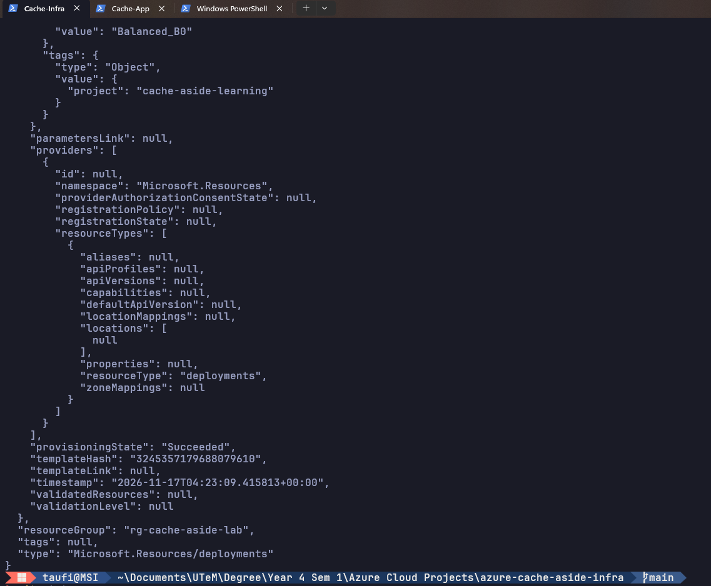
*Azure CLI output showing the deployment outputs including the Redis SKU and tags.*

### 5.5 Destroy

Delete the resource group when you finish.

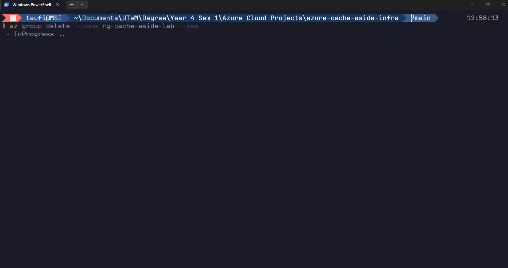
*Azure CLI output showing the resource group deletion in progress.*

The portal shows the group in the Deleting state while its resources are removed.

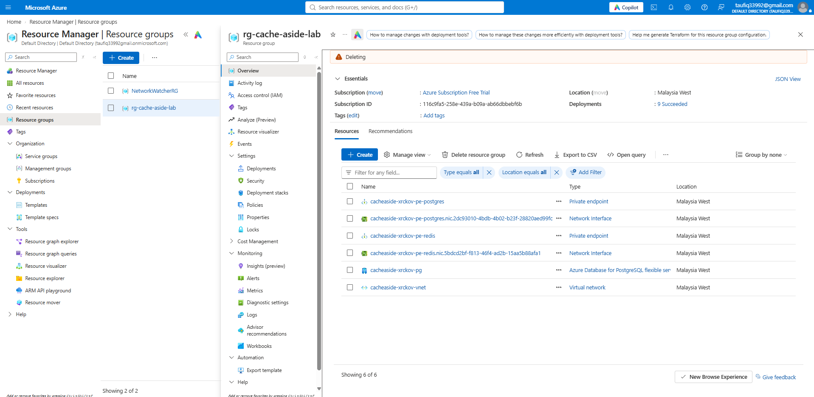
*Azure portal showing the resource group and its resources while deletion is in progress.*

After the deletion finishes, the portal no longer lists the group. Only the automatically created `NetworkWatcherRG` remains.

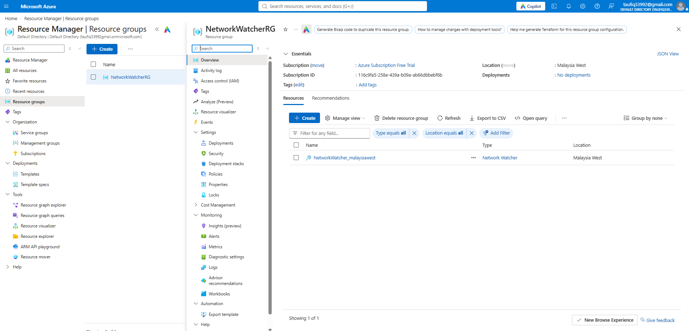
*Azure portal showing only NetworkWatcherRG after the resource group was deleted.*

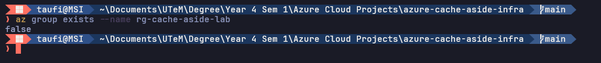
*Azure CLI output showing az group exists returns false.*

## 6. Differences from the reference architecture

| Reference architecture | This project | Reason |
|---|---|---|
| High availability for Redis and PostgreSQL | Turned off | Lower cost |
| Production sizing | Smallest SKUs | Learning only |
| Least-privilege database roles | App identity is a PostgreSQL Entra administrator | Lets the app create its own schema |
| Durable invalidation, such as an outbox | Not implemented | The TTL limits stale data |

## 7. What I learned

- Capacity is a regional and per-SKU limit. `Balanced_B0` and `Balanced_B1` were both unavailable in Southeast Asia, but `Balanced_B0` deployed in Malaysia West.
- You can't change the region of existing resources by redeploying. Delete the resource group and create it again.
- `what-if` can't preview nested modules that depend on other modules' outputs.
- Running a bash script from PowerShell opens a separate Git Bash window that closes when the script ends, so the output disappears.

## 8. Related resources

- [cache-aside-app](https://github.com/tttaufiqqq/azure-cache-aside-app): the web app repository
- [Implementation log](docs/implementation-log.md)
- [Troubleshooting](docs/troubleshooting.md)
- [Azure Architecture Center article](https://learn.microsoft.com/en-us/azure/architecture/databases/architecture/cache-aside-azure-managed-redis-postgresql)
