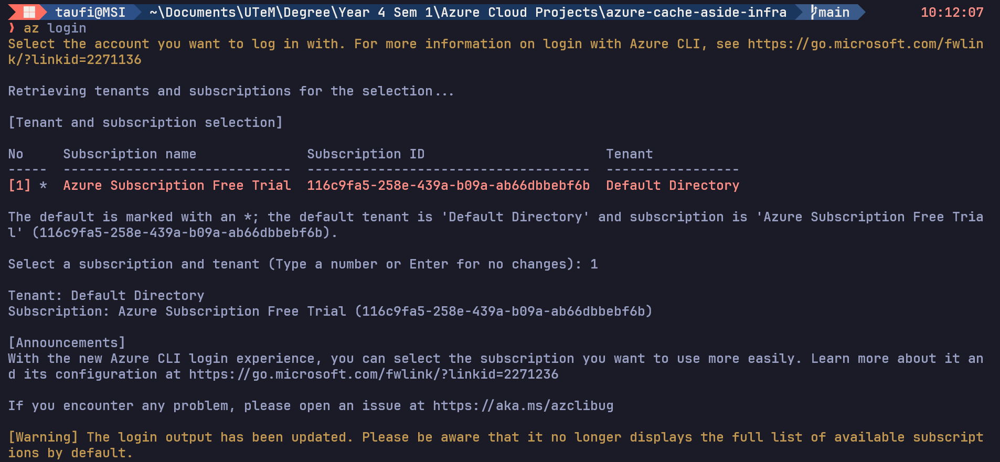
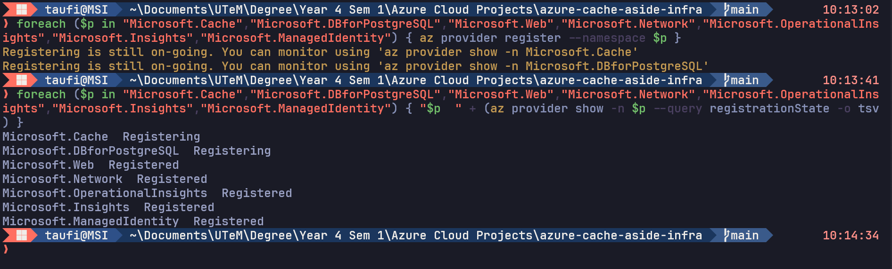
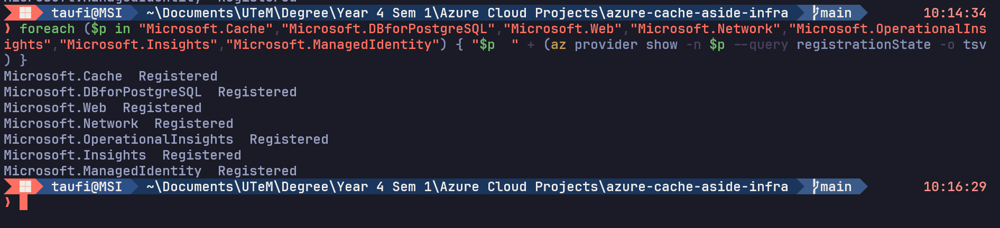
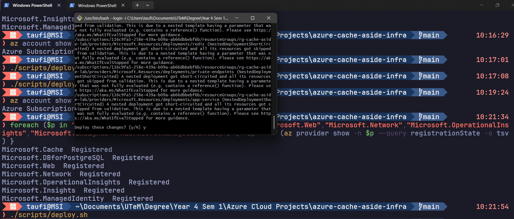
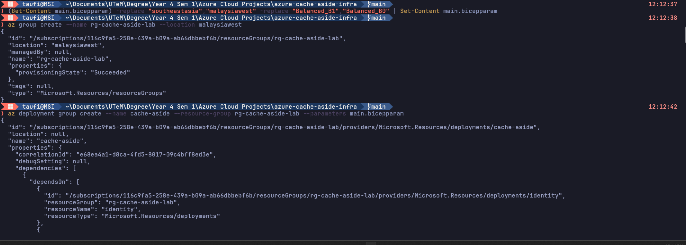
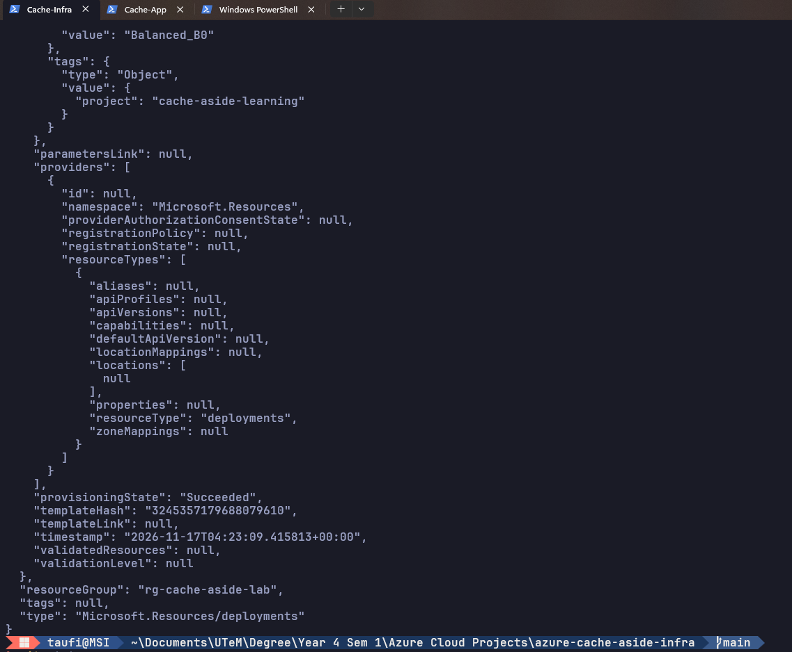
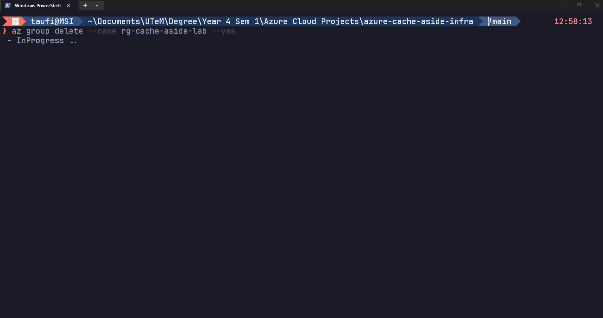
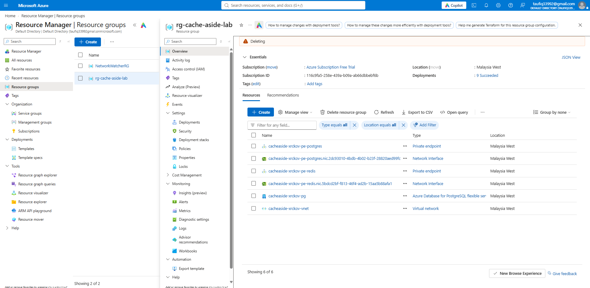
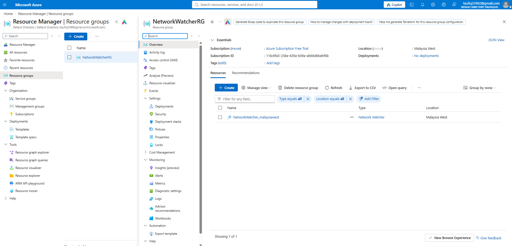
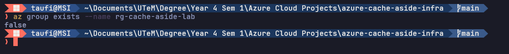

# Deploy, redeploy, and destroy

This article shows how to deploy the infrastructure, change it, and delete it.

## 1. Before you begin

- Sign in with `az login`.

  
  *Azure CLI az login output with the tenant and subscription selection.*

- Select your subscription with `az account set --subscription "<name>"`.
- Register the required resource providers once per subscription.

  ```powershell
  foreach ($p in "Microsoft.Cache","Microsoft.DBforPostgreSQL","Microsoft.Web","Microsoft.Network","Microsoft.OperationalInsights","Microsoft.Insights","Microsoft.ManagedIdentity") { az provider register --namespace $p }
  ```

  
  *Azure CLI output showing the foreach loop that registers the resource providers.*

  Registration can take a few minutes. Check each provider with `az provider show -n <name> --query registrationState -o tsv`.

  
  *Azure CLI output showing each provider state with Microsoft.Cache registered.*

- Confirm that Azure Managed Redis and your chosen SKUs have capacity in the target region. Capacity is only checked at deployment time.

## 2. Deploy with the script

Run the deploy script from the repository root in Git Bash or WSL.

```bash
./scripts/deploy.sh
```

The script:

1. Creates the resource group.
1. Runs `az deployment group what-if` and shows the planned changes.
1. Asks for confirmation.
1. Deploys `main.bicep` with `main.bicepparam`.
1. Prints the deployment outputs.

> [!NOTE]
> The preview doesn't list every resource. The nested modules depend on values that exist only during deployment, so `what-if` skips them.

## 3. Deploy with PowerShell

If you run the bash script from PowerShell, it opens its own Git Bash window and the output disappears when the script ends. Run the commands directly instead.


*Git Bash window that opens when the deploy script runs from PowerShell.*

```powershell
az group create --name rg-cache-aside-lab --location malaysiawest
az deployment group create --name cache-aside --resource-group rg-cache-aside-lab --parameters main.bicepparam
```

Deployment takes about 10 minutes because Redis and PostgreSQL provision slowly.

## 4. Change the configuration

Edit `main.bicepparam`, then deploy again.

| Parameter | Default | Description |
|---|---|---|
| `location` | `malaysiawest` | Azure region |
| `namePrefix` | `cacheaside` | Prefix for resource names |
| `appServiceSku` | `B1` | App Service plan size |
| `postgresSku` | `Standard_B1ms` | PostgreSQL compute size |
| `redisSku` | `Balanced_B0` | Azure Managed Redis size |
| `cacheTtlSeconds` | `60` | Default cache TTL |

You can override the resource group and region with environment variables when you use the script.

```bash
RESOURCE_GROUP=my-rg LOCATION=eastasia ./scripts/deploy.sh
```

> [!IMPORTANT]
> You can't change the region of existing resources by redeploying. To switch regions, destroy the resource group first.


*Azure CLI output showing the resource group recreated in Malaysia West.*

## 5. Use the outputs

The deployment prints `appName`, `appUrl`, `postgresHost`, and `redisHost`. Read them again at any time.

```bash
az deployment group show -g rg-cache-aside-lab -n cache-aside --query properties.outputs
```


*Azure CLI output showing the deployment outputs including the Redis SKU and tags.*

The `cache-aside-app` repository reads `appName` to deploy the app.

## 6. Destroy

Run the destroy script in Git Bash or WSL.

```bash
./scripts/destroy.sh
```

The script asks you to type the resource group name, then runs `az group delete --no-wait`. In PowerShell, delete the group directly.

```powershell
az group delete --name rg-cache-aside-lab --yes
```


*Azure CLI output showing the resource group deletion in progress.*

The portal shows the group in the Deleting state while its resources are removed.


*Azure portal showing the resource group and its resources while deletion is in progress.*

After the deletion finishes, the portal no longer lists the group. Only the automatically created `NetworkWatcherRG` remains.


*Azure portal showing only NetworkWatcherRG after the resource group was deleted.*

Check whether the group still exists.

```bash
az group exists --name rg-cache-aside-lab
```


*Azure CLI output showing az group exists returns false.*

## 7. Redeploy

After deletion finishes, deploy again. The name suffix comes from the resource group ID, so a recreated group in the same subscription reuses the same names.
