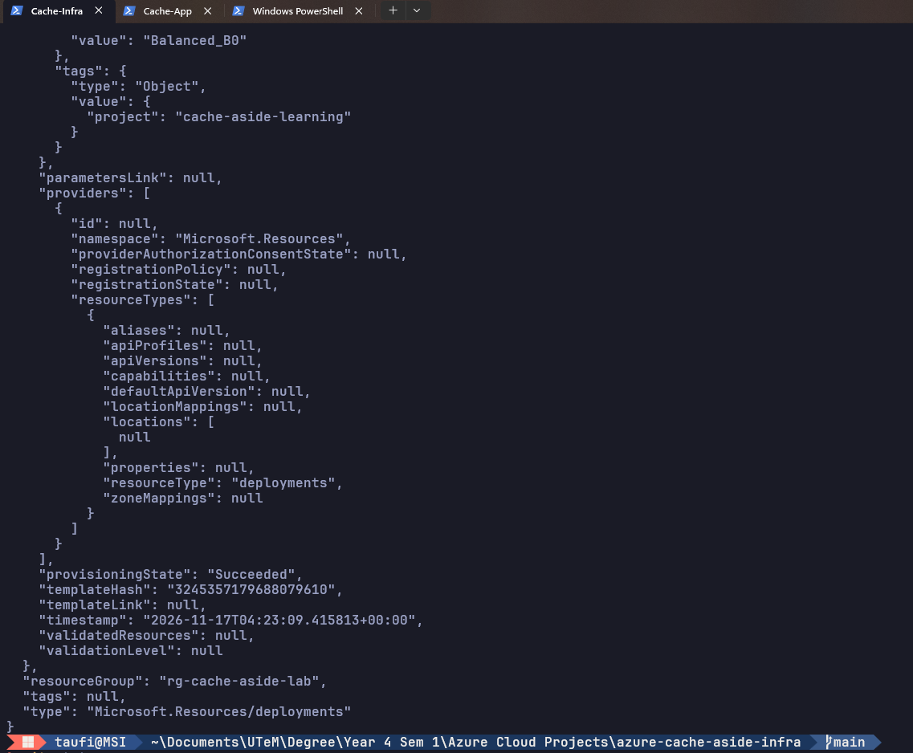
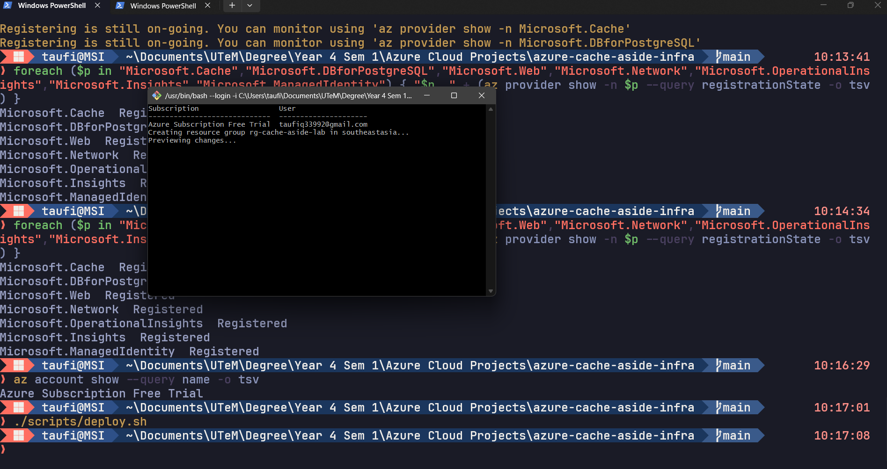
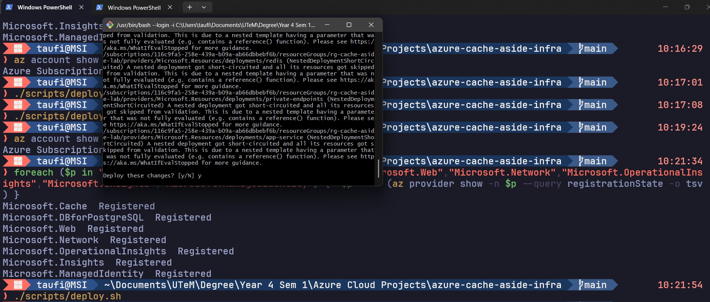
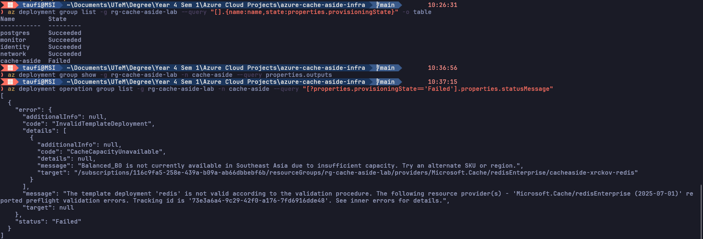
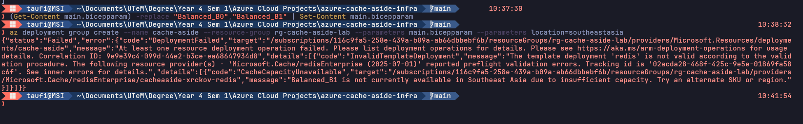
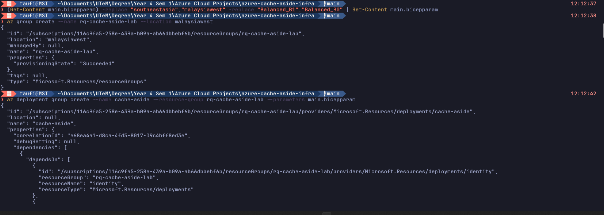

# Implementation log

This log records how the infrastructure was planned, deployed, and fixed on 17 November 2026. It lists what happened, what failed, and why each decision was made.

## 1. Goal

Implement the [Azure Architecture Center cache-aside architecture](https://learn.microsoft.com/en-us/azure/architecture/databases/architecture/cache-aside-azure-managed-redis-postgresql) as a learning project. The requirements were:

- Use the lightest stack that still shows the pattern.
- Define everything as code so the environment can be destroyed and redeployed at any time.
- Keep two repositories: one for Azure and one for the web app.

## 2. Decisions

| Decision | Choice | Reason |
|---|---|---|
| IaC tool | Bicep | Built into the Azure CLI, no state file, and no provider download |
| Destroy method | One resource group, deleted with `az group delete` | One command removes every resource |
| Data access | Private endpoints, public access off | Matches the reference architecture |
| Authentication | One user-assigned managed identity for both services | No passwords or keys to store |
| PostgreSQL role for the app | Identity is a Microsoft Entra administrator | The database is private-only, so no manual SQL step is possible |
| SKUs | App Service B1, PostgreSQL B1ms, Redis Balanced B0 | Smallest sizes that support the design |
| Name suffix | `uniqueString` of the resource group ID | Avoids global name collisions and stays stable across redeploys |

## 3. Timeline

| Step | What happened | Result |
|---|---|---|
| 1 | Wrote the Bicep modules and checked them with `az bicep build` and lint | No errors |
| 2 | Registered the resource providers | Worked after fixing the shell syntax (see below) |
| 3 | Ran `./scripts/deploy.sh` from PowerShell for Southeast Asia | A separate Git Bash window opened and closed before the output could be read |
| 4 | Listed the deployments from PowerShell | `identity`, `monitor`, `network`, and `postgres` succeeded, and the main deployment failed |
| 5 | Read the failed operation | `CacheCapacityUnavailable` for `Balanced_B0` in Southeast Asia |
| 6 | Changed `redisSku` to `Balanced_B1` and redeployed | The same error for `Balanced_B1` |
| 7 | Deleted the resource group, set the region to Malaysia West, set `redisSku` back to `Balanced_B0`, and redeployed | Succeeded in about 10 minutes |
| 8 | Read the deployment outputs | App name, app URL, PostgreSQL host, and Redis host |
| 9 | Deployed the app from the `cache-aside-app` repository | See that repository's log |

The outputs from step 8 include the Redis SKU and the resource tags.

*Azure CLI output showing the deployment outputs including the Redis SKU and tags.*

## 4. Problems and fixes

### 4.1 Provider registration failed in PowerShell

The `for p in ...; do ... done` loop is bash syntax, and PowerShell rejected it. The fix was the PowerShell `foreach` loop in [Deploy, redeploy, and destroy](deploy.md). Two providers, `Microsoft.Cache` and `Microsoft.DBforPostgreSQL`, took a short while to reach `Registered`.

*PowerShell output showing Microsoft.Cache and Microsoft.DBforPostgreSQL still registering.*

### 4.2 The what-if preview was incomplete

The preview listed eight resources to create. The postgres, redis, private-endpoints, and app-service modules appeared as `NestedDeploymentShortCircuited` because their inputs depend on values that exist only during deployment. This was expected and not an error.

### 4.3 The deploy script window closed

PowerShell passed the bash script to Git Bash, which opened its own window and closed it when the script ended. The result was only visible by running `az deployment group list` afterward. Running `az deployment group create` directly in PowerShell avoids the problem.

*Git Bash window that opens when the deploy script runs from PowerShell.*

*Azure CLI output listing the deployments and the failed operation status.*

### 4.4 Redis capacity in Southeast Asia

Azure rejected `Balanced_B0` and then `Balanced_B1` with `CacheCapacityUnavailable`. Capacity is limited per region and per SKU, and `what-if` can't detect it. Azure Managed Redis supports Malaysia West, so the deployment moved there.

*Azure CLI output showing the redisSku change to Balanced_B1 and the failed redeploy in Southeast Asia.*

### 4.5 Changing region requires a clean start

Existing resources can't change region through a redeployment. The resource group was deleted before the Malaysia West deployment, and the same resource names were reused because the suffix comes from the resource group ID.

*Azure CLI output showing the resource group recreated in Malaysia West.*

## 5. What worked

- Postgres, the network, the identity, and monitoring succeeded on the first attempt.
- The Malaysia West deployment finished in about 10 minutes with `Balanced_B0`.
- The Redis access policy and the PostgreSQL Entra administrator were created by Bicep with no manual steps.
- The private endpoints and DNS zone groups resolved correctly, which the app confirmed later by reaching both services.

## 6. Related resources

- [Deploy, redeploy, and destroy](deploy.md)
- [Troubleshooting](troubleshooting.md)
- [Architecture](architecture.md)
