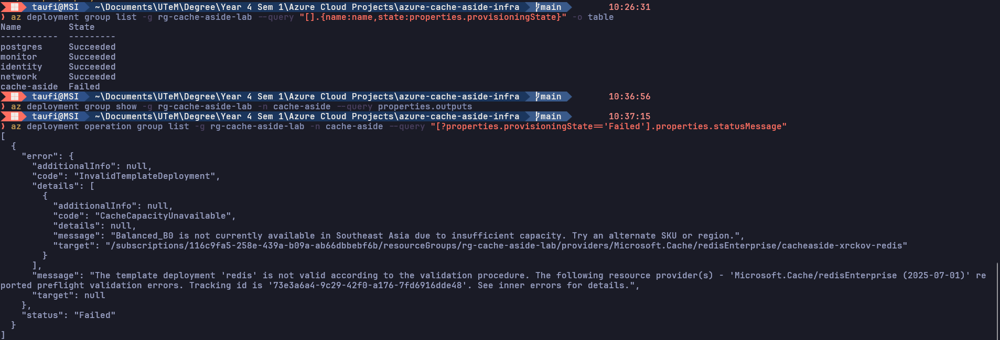
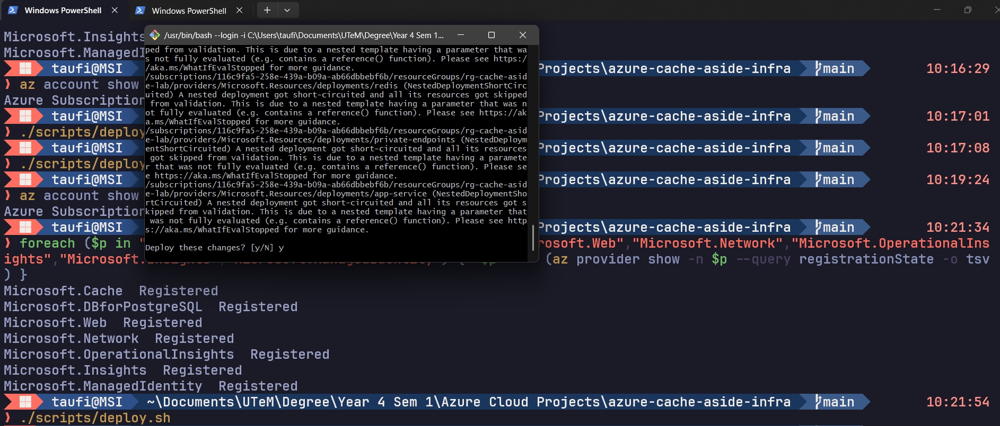
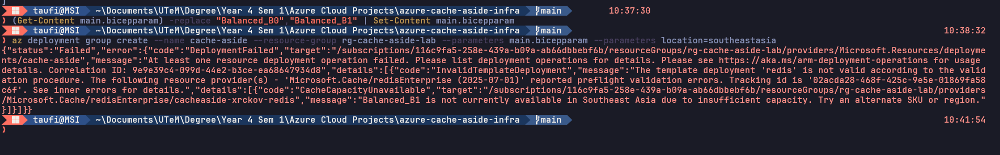

# Troubleshooting

This article lists common deployment problems and how to resolve them.

## Read the deployment error

Show the failed operations for the deployment.

```bash
az deployment operation group list \
  --resource-group rg-cache-aside-lab \
  --name cache-aside \
  --query "[?properties.provisioningState=='Failed'].properties.statusMessage"
```



## The deploy script window closes

**Symptom:** You run `./scripts/deploy.sh` in PowerShell, a Git Bash window opens, and it closes before you can read the result.



**Fix:** Check the result from PowerShell.

```powershell
az deployment group list -g rg-cache-aside-lab --query "[].{name:name,state:properties.provisioningState}" -o table
```

To watch the output live, run `az deployment group create` directly, as described in [Deploy, redeploy, and destroy](deploy.md).

## CacheCapacityUnavailable

**Symptom:** Redis fails with `CacheCapacityUnavailable` and a message that the SKU is not available in the region due to insufficient capacity.

**Fix:** Capacity is limited per region and per SKU.

1. Try the next size by setting `redisSku` to `Balanced_B1` in `main.bicepparam`.

   

1. If that fails too, change `location` to another region that supports Azure Managed Redis.
1. Because existing resources can't move, delete the resource group before you deploy to a different region.

## The region or SKU is unavailable

**Symptom:** PostgreSQL or App Service fails with a capacity, region, or quota error.

**Fix:** Change `location` or the SKU in `main.bicepparam`. Free trial subscriptions have stricter quotas.

## The app resolves a public IP address

**Symptom:** The app can't reach Redis or PostgreSQL, and DNS returns a public address.

**Fix:**

1. Confirm that each private DNS zone has a virtual network link.
1. Confirm that each private endpoint has a DNS zone group.
1. Confirm that `vnetRouteAllEnabled` is `true` on the web app.

Test resolution from the app's SSH console in the Kudu site.

```bash
nslookup <redisHost>
```

## The app can't authenticate to Redis

**Symptom:** The app connects but Redis rejects the login.

**Fix:**

- Confirm that the access policy assignment exists on the `default` database.
- Confirm that `AZURE_CLIENT_ID` matches the managed identity client ID.
- Use the host name from the `redisHost` output, not the `privatelink` name.

## The app can't authenticate to PostgreSQL

**Symptom:** PostgreSQL rejects the connection or the role doesn't exist.

**Fix:**

- Confirm that the identity is listed as a Microsoft Entra administrator on the server.
- Confirm that `PGUSER` equals the managed identity name.
- Check the app logs in Log Analytics for token errors.

## The deployment fails with a name conflict

**Symptom:** A resource name is already taken.

**Fix:** Change `namePrefix` in `main.bicepparam`. Names are global for PostgreSQL, Redis, and the web app.
